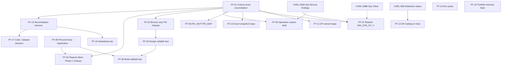

# 03 — Proposed epic and story map

Draft only. Nothing has been created in Jira. Story IDs `FF-xx` are placeholders.

## Epic (draft)

**Title:** Financial Forecasting — CARL Source Alignment

**Project / type:** CARL, Epic. Suggested labels: `financial-forecasting`, `df-team`, `carl-alignment`.

**Objective.** Bring the Financial Forecasting pipeline's source data onto governed CARL Iceberg/Cube where it makes sense, or record a deliberate decision where it does not, so that the forecast reconciles with other CARL FreeWheel and Operative reporting and every data pull is tracked and tested in Jira.

**Context.** The pipeline reads 11 Snowflake share objects, refreshes two Finance capacity tables daily on Databricks, and serves QuickSight from DF Gold views. None of it reads CARL Iceberg or Cube today. See [01](01-carl-iceberg-cube-inventory-and-gaps.md).

**Working model (from Daya, 20 Oct).**
- The DF team does the data pull directly. There is **no internal dependency on the CARL team** for the pull.
- Debarghyo Sengupta assigns someone to help Kaustuva's team get started.
- Everything is tracked in Jira with proper testing.
- Where CARL platform work is unavoidable (prod Glue registration, FreeWheel Silver additions), it is **linked as a dependency**, not owned by this epic.

**In scope.** Source repointing, missing-object builds or decisions, reference-data governance, reconciliation, environment parity, and the Cube/dataset decision.

**Out of scope.**
- Rebuilding the forecast model or the capacity logic.
- The CARL-1364 pacing dashboard and CARL-1479 EPM feed (separate epics; see [02](02-existing-jira-epics-and-overlap.md)).
- FreeWheel decoupling from the third-party enriched feed (AI-087, owned elsewhere).
- Changing QuickSight dashboards, unless FF-17 decides to.

**Success criteria.**
1. Each of the 11 source objects has a recorded disposition: repointed to CARL, rebuilt in CARL, or retained with a reason and an owner.
2. Repointed sources reconcile to the current Gerry-side share within agreed tolerances (FF-14), signed off by Finance.
3. All new CARL reads work in the target environments with documented parity (FF-15).
4. Every story has test evidence attached in Jira.

**Risks.** FreeWheel is dev-only in Glue; Silver Phase 1 excludes several needed tables; Operative Bronze is all strings with malformed names; FreeWheel source retention is 7 days against a 7-day rebuild window; decoupling has no date; prioritisation from Rohini is outstanding.

## Story list

| ID | Title | Objects / gap | Type | Owner (suggested) | Size* | Wave | Depends on |
|---|---|---|---|---|---|---|---|
| [FF-01](stories/FF-01-column-level-reconciliation-of-source-objects.md) | Column-level reconciliation of the 11 source objects against CARL | All; Q4 | Spike | DF team (Venkatesh D / assignee from Debarghyo) | S | 0 | — |
| [FF-15](stories/FF-15-environment-parity-dev-qa-prod.md) | Document and verify DEV/QA/PROD parity for the Finance forecast pipeline | G11; Q1 | Analysis | Kaustuva Hota's team | S | 0 | — |
| [FF-12](stories/FF-12-portfolio-forecast-recurring-prod-feed.md) | Decide and design a recurring prod feed for `VW_PORTFOLIO_FORECASTING_FORECAST` | G8; Q2 | Spike | Ankit Gajiwala | S | 0 | — |
| [FF-14](stories/FF-14-reconciliation-harness-and-parallel-run.md) | Reconciliation harness and parallel run: Gerry-side share vs CARL | G10 | Story | DF team | M | 1 | FF-01 |
| [FF-02](stories/FF-02-repoint-freewheel-lookups-in-silver-phase-1.md) | Repoint FreeWheel lookups already in Silver Phase 1 (`dim_video`, `dim_placement`, `dim_site`, `dim_site_section`) | Objects 5, 7 (partly), 2/4 (partly) | Story | DF team | M | 1 | FF-01, FF-09 (for prod) |
| [FF-08](stories/FF-08-repoint-operative-custom-field-lookup.md) | Repoint `OPERATIVE_SALES_ORDER_CUSTOM_FIELD_V` to `operative_bronze` | Object 10; G6 | Story | DF team | M | 1 | FF-01; CARL-3509 findings |
| [FF-03](stories/FF-03-freewheel-bronze-only-lookups-decision-and-repoint.md) | Decide and repoint FreeWheel lookups that are Bronze-only (site-group family, video-group family, listings) | Objects 2, 3, 4, 5, 6; G2 | Story | DF team + Hong Zhang (consult) | M | 1–2 | FF-01 |
| [FF-09](stories/FF-09-freewheel-prod-glue-registration.md) | Register FreeWheel Bronze (and Silver) in the prod Glue catalog | G1 | Dependency (CARL) | CARL platform | M | 1 | CARL-3852 decision |
| [FF-11](stories/FF-11-govern-df-owned-reference-maps.md) | Govern the three DF-owned reference maps | G7 | Story | Kaustuva Hota's team | S | 2 | FF-01 |
| [FF-10](stories/FF-10-govern-excel-snapshot-maps.md) | Plan and implement governed reference data for the Looker Excel snapshot maps (`EXCEL_SHEETS_V`) | Object 11; G7 | Story | Gerry (owner) + DF team | M | 2 | FF-01 |
| [FF-06](stories/FF-06-governed-fw-vidtype-map.md) | Provide `FW_VIDTYPE_MAP` as governed reference data | Object 8; G4 | Story | DF team | S | 2 | FF-01 |
| [FF-04](stories/FF-04-design-carl-aligned-sellable-revenue-fact.md) | Design the CARL-aligned equivalent of `FW_REV_VIDEOASSET_DY_SELLABLE_V` | Object 1; G3 | Design spike | DF team + Hong Zhang (consult) | M | 2 | FF-01, FF-03 |
| [FF-07](stories/FF-07-rebuild-om-con-dy-on-operative-bronze.md) | Rebuild `OM_CON_DY_V` logic on `operative_bronze` | Object 9; G5 | Story | DF team + Mike Hodge (consult) | L | 2 | FF-01; CARL-3509; CARL-2888 |
| [FF-05](stories/FF-05-build-sellable-revenue-fact-in-carl.md) | Build the sellable revenue video-asset-day table in CARL Silver/Gold | Object 1; G3 | Story | To be decided | L | 3 | FF-04, FF-09; priority from Rohini |
| [FF-13](stories/FF-13-df-iceberg-visibility-in-glue.md) | Decide and (if wanted) implement Glue visibility for DF Snowflake-managed Iceberg | G9 | Decision / Story | Debarghyo Sengupta | M | 3 | CARL-580 status confirmed |
| [FF-17](stories/FF-17-cube-view-and-dataset-decision.md) | Decide Cube semantic view and QuickSight dataset path for Finance capacity forecast | G12 | Decision | Daya Thakur / Rohini Vugumudi | S | 3 | FF-14; priority from Rohini |
| [FF-16](stories/FF-16-modularise-finance-forecast-refresh-job.md) | Modularise `DF_Run_Finance_Forecast_Capacity` | DF backlog | Story (optional) | Kaustuva Hota's team | M | Parked | FF-14 |

\*Size is a T-shirt estimate (S ≤ 3 days, M ≈ 1–2 weeks, L > 2 weeks) and is **unvalidated**; refine in grooming.

## Waves

| Wave | Purpose | Stories |
|---|---|---|
| 0 — Start now | Settle facts; no CARL dependency | FF-01, FF-15, FF-12 |
| 1 — Repoint what exists | Read CARL where a table already exists | FF-02, FF-08, FF-03, FF-09, FF-14 |
| 2 — Fill reference and logic gaps | Govern maps; design and rebuild logic | FF-11, FF-10, FF-06, FF-04, FF-07 |
| 3 — Build and decide | Net-new CARL builds and architecture choices, gated on priority | FF-05, FF-13, FF-17 |
| Parked | DF-internal, not needed for alignment | FF-16 |

## Dependency map

## Definition of Done (applies to every story)

Daya's requirement is that everything is tracked in Jira with proper testing. Every story is done only when:

1. Acceptance criteria are met in **dev and QA**, and in prod where the story touches prod.
2. **Test evidence is attached** to the Jira ticket: queries run, row counts, reconciliation output, sign-off comment.
3. The Jira ticket links to its epic, its dependency stories and any related CARL ticket.
4. Access follows least privilege. If Financial Forecasting is SOX-scoped (Q7), controls are recorded.
5. Documentation is updated: the object-to-CARL mapping in FF-01 is amended with the new disposition.
6. A second person reviews the change (PR review or query review) before it moves to Done.

## Standard test approach

| Test | Applies to | What is checked |
|---|---|---|
| Structure | All repoints | Column names, types and nullability match the old object or differences are documented |
| Volume | All repoints | Row counts by date over a defined window match within tolerance |
| Value | Facts and measures | Sums, distinct counts and key measures reconcile per day and per dimension |
| Window | FreeWheel reads | The last 7 activity dates and late-arriving corrections behave as in the current job |
| Environment | All | Same result and shape in dev and QA; prod only after FF-09 and FF-15 |
| Regression | Pipeline | `CAPACITY_HISTORY_FINANCE` and `CAPACITY_FORECAST_FINANCE` unchanged within tolerance after the repoint |
| Negative | Reference maps | Unmapped values are surfaced, not silently dropped |

Tolerances are not set in the source thread. FF-14 proposes them and Finance signs them off.

## Decisions needed from Daya

1. Confirm the epic scope boundary against CARL-1364 and CARL-1479 (Q5).
2. Confirm the DF team owns stories end to end, with CARL stories linked as dependencies only.
3. Confirm whether FF-16 stays parked.
4. Decide whether SOX applies (Q7).
