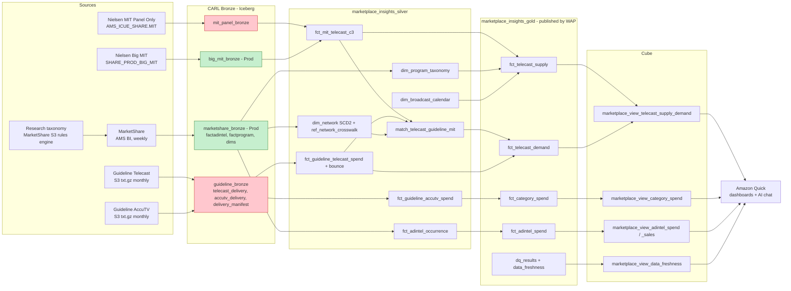
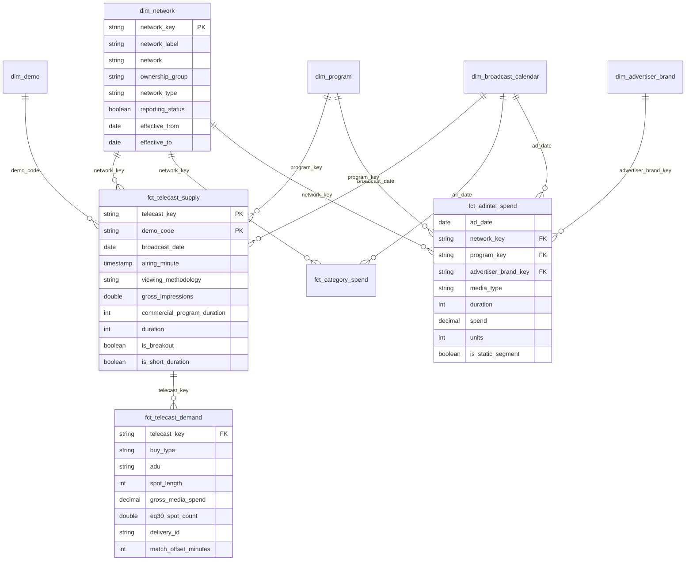
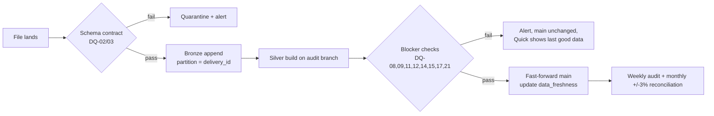

# Research Market Share: Iceberg + Cube discovery

Jira: [CARL-3776](https://wbdprod.atlassian.net/browse/CARL-3776) (epic [CARL-3775](https://wbdprod.atlassian.net/browse/CARL-3775)). Generated 12 Oct 2026 by `build_workbook.py`; detail in `MarketShare_Research_Discovery_Iceberg_Cube.xlsx`.

## Priority needs (P0)

- **PN-01 Join Nielsen MIT C3 impressions to Guideline:Telecast spend at telecast level**: Silver match bridge (Guideline telecast to Nielsen telecast, +/- N minutes) feeding two Gold facts that share a telecast key: supply (impressions) and demand (spend). Keeping them separate stops impressions being multiplied by buy-type rows.
- **PN-02 Numbers within +/-3% of source, with errors caught before analysts start**: DQ framework (Data Quality Plan sheet) using write-audit-publish: Gold is only published when blocker checks pass. Results land in an Iceberg dq_results table, and a monthly reconciliation runs against vendor UIs and the VAMI baseline.
- **PN-03 Stitched viewership: Panel Only through 28-Sep-2025, Big Data + Panel from 29-Sep-2025, and analysts can always tell which**: Silver fct_mit_telecast_c3 carries both methodologies with a viewing_methodology column. An is_reporting_methodology flag is driven by a config row (the cutover date), not hard-coded. Overlap window 05-Aug-2024 to 31-Dec-2025 is kept for comparison.
- **PN-04 Ad Intel spend without duplicates or stale revisions**: Phase 1: Silver from marketshare_bronze.factadintel with duplicate detection and an is_static_segment flag. Phase 2: direct Ad Intel occurrence feed with a MERGE on Nielsen's occurrence key so revisions replace rather than append.
- **PN-05 One internal taxonomy for network, ownership, portfolio, genre and reporting status, replacing XREF_NETWORK and VAMI_REPORTING_NETWORKS**: Conformed dim_network (effective-dated) built from marketshare_bronze.dimnetwork, which already has ownershipgroup and reportingstatus. Add a managed Guideline-to-Nielsen network crosswalk with explicit cardinality, plus dim_program_taxonomy from dimnetworkprogramnamemapping.
- **PN-06 Notifications (delivery, ETL done, errors) and a visible 'last updated'**: Delivery manifest table, schema-contract check at landing, a data_freshness table per source and layer, and alerts to the Marketplace Insights channel. The freshness tile goes on every Quick dashboard.

Field coverage from the intake: 113 fields, 47 available on CARL Bronze today, 30 blocked on Guideline landing.

## Target lineage

Green = in CARL Prod today, red = not yet landed.

## Gold ERD

## Data quality gate

## Decisions needed first

- **Q-01** custom_mit2 ranks breakout airings first in code but the doc says non-breakout first. Which should receive Guideline spend? (Eric Yarsinsky / Maggie Mullane)
- **Q-02** Cutover: Panel Only through 28-Sep-2025 and Big MIT from 29-Sep-2025? (Pain_Points says 26-Sep and '2026') (Eric Yarsinsky)
- **Q-03** Panel Only history: one-time backfill from AMS_ICUE_SHARE.MIT, or use marketshare factprogram? (AMS BI (Hong Zhang, Sean Malek) + Research)
- **Q-04** Ad Intel: can CARL get the raw occurrence feed (and Nielsen's occurrence id)? Is the factAdIntel duplicate fix confirmed for all years? (AMS BI (Sean Malek))
- **Q-05** Ad Intel CTV: who procures and owns the ingestion? (Research sponsor + AMS BI)
- **Q-06** Truth source: vendor file or vendor UI? (Research + CARL)
- **Q-07** CARL read access to s3 aws-ams-bi-marketshare-developer/DataOutgoing, or redirect Guideline delivery to CARL landing? (AMS BI + CARL DE)
- **Q-08** Bounce depth: 3 or 6 final deliveries? Is 'final' = last file before the next cycle's first file? (Eric Yarsinsky)
