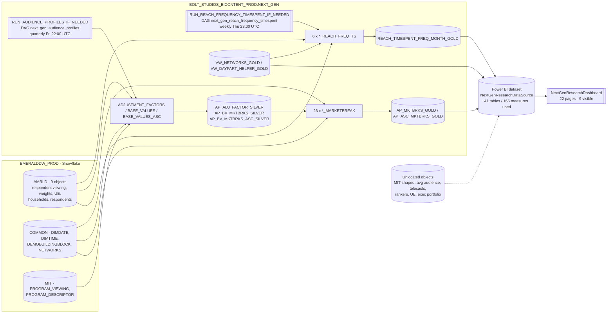
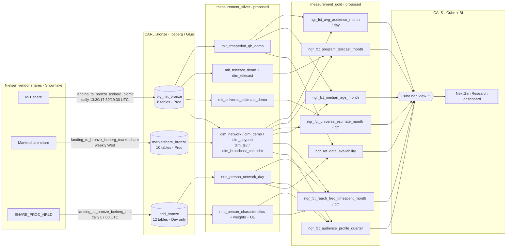

# NextGen Research - ERD and lineage

Generated 08 Oct 2026 from `evidence/pbix_report.json` and `knowledge.py`.
Relationships in the current-state ERD come from the model diagram's subject-area groupings. The `.pbix` does not hold the actual relationship keys, so treat the edges as "related", not as proven joins, until the TMDL export (NGR-01) is in.

## 1. Current state lineage (Snowflake)

## 2. Target lineage (CARL Bronze -> Silver -> Gold -> Cube)

## 3. Current Power BI model ERD (inferred from diagram groups)

```mermaid
erDiagram
    WM_NETWORKS ||--o{ WM_MEDIAN_AGE_MONTH : "filters"
    WM_TSV ||--o{ WM_MEDIAN_AGE_MONTH : "filters"
    WM_BROADCAST_CALENDAR ||--o{ WM_MEDIAN_AGE_MONTH : "filters"
    WM_DAYPART ||--o{ WM_MEDIAN_AGE_MONTH : "filters"
    WM_BROADCAST_CALENDAR ||--o{ WM_AVG_AUDIENCE_MONTH : "filters"
    WM_DEMO ||--o{ WM_AVG_AUDIENCE_MONTH : "filters"
    WM_NETWORKS ||--o{ WM_AVG_AUDIENCE_MONTH : "filters"
    WM_TSV ||--o{ WM_AVG_AUDIENCE_MONTH : "filters"
    WM_DAYPART ||--o{ WM_AVG_AUDIENCE_MONTH : "filters"
    UNIVERSE ||--o{ WM_AVG_AUDIENCE_MONTH : "filters"
    WM_DATE_SELECTION ||--o{ WM_AVG_AUDIENCE_MONTH : "filters"
    TIME_PERIOD ||--o{ WM_REACH_AND_FREQUENCY : "filters"
    WM_DATE_SELECTION ||--o{ WM_REACH_AND_FREQUENCY : "filters"
    WM_BROADCAST_CALENDAR ||--o{ WM_REACH_AND_FREQUENCY : "filters"
    WM_NETWORKS ||--o{ WM_REACH_AND_FREQUENCY : "filters"
    WM_DEMO ||--o{ WM_REACH_AND_FREQUENCY : "filters"
    WM_TSV ||--o{ WM_REACH_AND_FREQUENCY : "filters"
    WM_DAYPART ||--o{ WM_REACH_AND_FREQUENCY : "filters"
    WM_BROADCAST_CALENDAR ||--o{ NET_AUDIENCE_NEW : "filters"
    WM_NETWORKS ||--o{ NET_AUDIENCE_NEW : "filters"
    ASC_AUDIENCE_NEW }o--o{ NET_AUDIENCE_NEW : "same subject"
    WM_DAYPART ||--o{ NET_AUDIENCE_NEW : "filters"
    GENDER_SKEW_AP }o--o{ NET_AUDIENCE_NEW : "same subject"
    WM_DAYPART_ALL ||--o{ AD_SALES_RANKERS_LW_LSD : "filters"
    WM_DEMO ||--o{ AD_SALES_RANKERS_LW_LSD : "filters"
    WM_NETWORKS ||--o{ AD_SALES_RANKERS_LW_LSD : "filters"
    WM_DAYPART ||--o{ AD_SALES_RANKERS_LW_LSD : "filters"
    AD_SALES_RANKERS_MONTH_LSD }o--o{ AD_SALES_RANKERS_LW_LSD : "same subject"
    WM_BROADCAST_CALENDAR ||--o{ AD_SALES_RANKERS_LW_LSD : "filters"
    WM_UE_CALENDAR ||--o{ WM_UNIVERSE_ESTIMATE_MONTH : "filters"
    WM_NETWORKS ||--o{ WM_UNIVERSE_ESTIMATE_MONTH : "filters"
    WM_UNIVERSE_ESTIMATE_QUARTER }o--o{ WM_UNIVERSE_ESTIMATE_MONTH : "same subject"
    WM_BROADCAST_CALENDAR ||--o{ WM_UNIVERSE_ESTIMATE_MONTH : "filters"
    WM_NETWORKS ||--o{ CHANNEL_PERFORMANCE : "filters"
    WM_DEMO ||--o{ CHANNEL_PERFORMANCE : "filters"
    WM_TSV ||--o{ CHANNEL_PERFORMANCE : "filters"
    WM_DAYPART ||--o{ CHANNEL_PERFORMANCE : "filters"
    WM_BROADCAST_CALENDAR ||--o{ CHANNEL_PERFORMANCE : "filters"
    PREMIERES }o--o{ CHANNEL_PERFORMANCE : "same subject"
    WM_BROADCAST_CALENDAR ||--o{ EXEC_PORTFOLIO_BY_DAY_L3 : "filters"
    WM_TSV ||--o{ EXEC_PORTFOLIO_BY_DAY_L3 : "filters"
    WM_DAYPART ||--o{ EXEC_PORTFOLIO_BY_DAY_L3 : "filters"
    WM_DEMO ||--o{ EXEC_PORTFOLIO_BY_DAY_L3 : "filters"
    WM_NETWORKS ||--o{ EXEC_PORTFOLIO_BY_DAY_L3 : "filters"
    WM_DATE_SELECTION ||--o{ EXEC_PORTFOLIO_BY_DAY_L3 : "filters"
    EXEC_PORT_TIERED_GROUPS ||--o{ EXEC_PORTFOLIO_BY_DAY_L3 : "filters"
    AD_SALES_RANKERS_LW_LSD {
        string AIRING
        string NETWORK
        string PROGRAM_NAME
    }
    AD_SALES_RANKERS_MONTH_LSD {
        string NETWORK
        string PROGRAM_NAME
    }
    CHANNEL_PERFORMANCE {
        string DOW
    }
    EXEC_PORTFOLIO_BY_DAY_L3 {
        string BroadcastDayKey
        string BroadcastMonthKey
        string DELIVERY
    }
    EXEC_PORT_TIERED_GROUPS {
        string DISPLAY
        string LOGO
    }
    GENDER_SKEW_AP {
        string DELIVERY
        string GENDER
        string Gender_Displaye
    }
    TIME_PERIOD {
        string Time_Period
    }
    UNIVERSE {
        string UNIVERSE
    }
    WM_AVG_AUDIENCE_MONTH {
        string DELIVERY
    }
    WM_BROADCAST_CALENDAR {
        string BC_Month
        string BC_Month_Text
        string BC_Quarter
        string BC_Year
        string BROADCAST_MONTH_KEY
    }
    WM_DATE_SELECTION {
        string Date
        string Display
        string Period
        string Selection
        string TSV
        string TimePeriodID
        string TimePeriodSwitcher
        string YoYComparisonLogic
    }
    WM_DAYPART {
        string DAYPART
    }
    WM_DAYPART_ALL {
        string DAYPART
    }
    WM_DEMO {
        string DEMO_DESC
        string DEMO_DESC_FOR_EXEC_PORTFOLIO
    }
    WM_NETWORKS {
        string CONGLOMERATE
        string Column
        string DISPLAY
        string LOGO
        string Main_ASCO_Owners
        string NETWORK_TYPE_1
        string NETWORKLABEL
        string NETWORKTYPE
    }
    WM_TSV {
        string TSV
    }
    WM_UE_CALENDAR {
        string BROADCAST_QUARTER_KEY
        string YEAR
        string YEAR_QUARTER
    }
```

## 4. Target Gold star schema (proposed)

```mermaid
erDiagram
    dim_network ||--o{ ngr_fct_avg_audience_month : "network_key"
    dim_broadcast_calendar ||--o{ ngr_fct_avg_audience_month : "broadcast_month_key"
    dim_demo ||--o{ ngr_fct_avg_audience_month : "demo_code"
    dim_daypart ||--o{ ngr_fct_avg_audience_month : "daypart_code"
    dim_tsv ||--o{ ngr_fct_avg_audience_month : "tsv_code"
    dim_network ||--o{ ngr_fct_avg_audience_day : "network_key"
    dim_broadcast_calendar ||--o{ ngr_fct_avg_audience_day : "broadcast_month_key"
    dim_demo ||--o{ ngr_fct_avg_audience_day : "demo_code"
    dim_daypart ||--o{ ngr_fct_avg_audience_day : "daypart_code"
    dim_tsv ||--o{ ngr_fct_avg_audience_day : "tsv_code"
    dim_network ||--o{ ngr_fct_program_telecast_month : "network_key"
    dim_broadcast_calendar ||--o{ ngr_fct_program_telecast_month : "broadcast_month_key"
    dim_demo ||--o{ ngr_fct_program_telecast_month : "demo_code"
    dim_tsv ||--o{ ngr_fct_program_telecast_month : "tsv_code"
    dim_network ||--o{ ngr_fct_universe_estimate_month : "network_key"
    dim_broadcast_calendar ||--o{ ngr_fct_universe_estimate_month : "broadcast_month_key"
    dim_demo ||--o{ ngr_fct_universe_estimate_month : "demo_code"
    dim_network ||--o{ ngr_fct_median_age_month : "network_key"
    dim_broadcast_calendar ||--o{ ngr_fct_median_age_month : "broadcast_month_key"
    dim_daypart ||--o{ ngr_fct_median_age_month : "daypart_code"
    dim_tsv ||--o{ ngr_fct_median_age_month : "tsv_code"
    dim_network ||--o{ ngr_fct_reach_freq_timespent_month : "network_key"
    dim_broadcast_calendar ||--o{ ngr_fct_reach_freq_timespent_month : "broadcast_month_key"
    dim_demo ||--o{ ngr_fct_reach_freq_timespent_month : "demo_code"
    dim_daypart ||--o{ ngr_fct_reach_freq_timespent_month : "daypart_code"
    dim_tsv ||--o{ ngr_fct_reach_freq_timespent_month : "tsv_code"
    dim_network ||--o{ ngr_fct_audience_profile_quarter : "network_key"
    dim_broadcast_calendar ||--o{ ngr_fct_audience_profile_quarter : "broadcast_month_key"
    dim_daypart ||--o{ ngr_fct_audience_profile_quarter : "daypart_code"
    dim_network {
        bigint network_key
        bigint nielsen_network_id
        string network_label
        string network_name
        string display_name
        string conglomerate
        string main_asco_owner
        string portfolio_owner
        string owner_tier_group
    }
    dim_broadcast_calendar {
        int date_key
        date calendar_date
        string day_of_week
        int broadcast_week_key
        int broadcast_month_key
        date broadcast_month_start
        date broadcast_month_end
        string bc_month_text
        string bc_month_year
    }
    dim_demo {
        string demo_code
        string demo_desc
        string gender
        int age_min
        int age_max
        boolean is_exec_portfolio_demo
        int sort_order
    }
    dim_daypart {
        string daypart_code
        string daypart_name
        string daypart_set
        string days_of_week
        string start_time_et
        string end_time_et
        int sort_order
    }
    dim_tsv {
        string tsv_code
        boolean is_commercial
        int days_credited
        int sort_order
    }
    ngr_fct_avg_audience_month {
        int broadcast_month_key
        bigint network_key
        string demo_code
        string daypart_code
        string tsv_code
        string nielsen_data_type
        decimal_18_3_ avg_audience_000
        decimal_18_3_ put_total_000
        decimal_18_3_ put_asco_000
    }
    ngr_fct_avg_audience_day {
        int date_key
        bigint network_key
        string demo_code
        string daypart_code
        string tsv_code
        decimal_18_3_ avg_audience_000
        decimal_18_3_ put_total_000
        int minutes
        timestamp data_load_ts
    }
    ngr_fct_program_telecast_month {
        int broadcast_month_key
        bigint network_key
        bigint program_key
        string program_name
        string demo_code
        string tsv_code
        int telecast_count
        int premiere_count
        decimal_18_3_ avg_audience_000
    }
    ngr_fct_universe_estimate_month {
        int broadcast_month_key
        int broadcast_quarter_key
        bigint network_key
        string demo_code
        decimal_18_3_ ue_cov_000
        decimal_18_3_ ue_nat_000
        timestamp data_load_ts
    }
    ngr_fct_median_age_month {
        int broadcast_month_key
        bigint network_key
        string daypart_code
        string tsv_code
        decimal_5_2_ median_age_p2
        timestamp data_load_ts
    }
    ngr_fct_reach_freq_timespent_month {
        int broadcast_month_key
        bigint network_key
        string demo_code
        string daypart_code
        string tsv_code
        decimal_18_3_ reach_000
        decimal_18_3_ universe_000
        decimal_9_4_ reach_pct
        decimal_9_4_ avg_frequency_days
    }
    ngr_fct_audience_profile_quarter {
        int broadcast_quarter_key
        bigint network_key
        boolean is_asc_benchmark
        string daypart_code
        string marketbreak
        string marketbreak_value
        decimal_18_3_ viewers_000
        decimal_9_4_ comp_pct
        decimal_12_2_ median_value
    }
```

## 5. Fact tables to report pages

```mermaid
flowchart LR
  WM_REACH_AND_FREQUENCY["WM_REACH_AND_FREQUENCY"] --> P_KPIs_Trends(["KPIs Trends"])
  WM_AVG_AUDIENCE_MONTH["WM_AVG_AUDIENCE_MONTH"] --> P_Age_and_Gender(["Age and Gender"])
  WM_AVG_AUDIENCE_MONTH["WM_AVG_AUDIENCE_MONTH"] --> P_Audience_Profiles(["Audience Profiles"])
  WM_AVG_AUDIENCE_MONTH["WM_AVG_AUDIENCE_MONTH"] --> P_Channel_Performance(["Channel Performance"])
  WM_AVG_AUDIENCE_MONTH["WM_AVG_AUDIENCE_MONTH"] --> P_Daypart_Comparison(["Daypart Comparison"])
  WM_AVG_AUDIENCE_MONTH["WM_AVG_AUDIENCE_MONTH"] --> P_Delivery_Trends(["Delivery Trends (hidden)"])
  WM_AVG_AUDIENCE_MONTH["WM_AVG_AUDIENCE_MONTH"] --> P_Info__CC_year_and_qtr(["Info -CC year and qtr (hidden)"])
  WM_AVG_AUDIENCE_MONTH["WM_AVG_AUDIENCE_MONTH"] --> P_Info_CC_month(["Info-CC month (hidden)"])
  WM_AVG_AUDIENCE_MONTH["WM_AVG_AUDIENCE_MONTH"] --> P_KPIs_Trends(["KPIs Trends"])
  WM_AVG_AUDIENCE_MONTH["WM_AVG_AUDIENCE_MONTH"] --> P_Network_Tooltip(["Network Tooltip (hidden)"])
  WM_AVG_AUDIENCE_MONTH["WM_AVG_AUDIENCE_MONTH"] --> P_Network_Tooltip_YTD(["Network Tooltip YTD (hidden)"])
  WM_AVG_AUDIENCE_MONTH["WM_AVG_AUDIENCE_MONTH"] --> P_Portfolio_Share__000(["Portfolio Share &#39;000"])
  WM_AVG_AUDIENCE_MONTH["WM_AVG_AUDIENCE_MONTH"] --> P_Portfolio_Share_Trends(["Portfolio Share Trends"])
  WM_MEDIAN_AGE_MONTH["WM_MEDIAN_AGE_MONTH"] --> P_Age_and_Gender(["Age and Gender"])
  WM_MEDIAN_AGE_MONTH["WM_MEDIAN_AGE_MONTH"] --> P_Channel_Performance(["Channel Performance"])
  ASC_AUDIENCE_NEW["ASC_AUDIENCE_NEW"] --> P_Audience_Profiles(["Audience Profiles"])
  NET_AUDIENCE_NEW["NET_AUDIENCE_NEW"] --> P_Audience_Profiles(["Audience Profiles"])
  GENDER_SKEW_AP["GENDER_SKEW_AP"] --> P_Audience_Profiles(["Audience Profiles"])
  AD_SALES_RANKERS_LW_LSD["AD_SALES_RANKERS_LW_LSD"] --> P_Ad_Sales_Rankers(["Ad Sales Rankers (hidden)"])
  AD_SALES_RANKERS_MONTH_LSD["AD_SALES_RANKERS_MONTH_LSD"] --> P_Ad_Sales_Rankers(["Ad Sales Rankers (hidden)"])
  AD_SALES_RANKERS_MONTH_LSD["AD_SALES_RANKERS_MONTH_LSD"] --> P_Channel_Performance(["Channel Performance"])
  CHANNEL_PERFORMANCE["CHANNEL_PERFORMANCE"] --> P_Channel_Performance(["Channel Performance"])
  WM_UNIVERSE_ESTIMATE_MONTH["WM_UNIVERSE_ESTIMATE_MONTH"] --> P_TV_Universe(["TV Universe"])
  WM_UNIVERSE_ESTIMATE_QUARTER["WM_UNIVERSE_ESTIMATE_QUARTER"] --> P_TV_Universe(["TV Universe"])
  EXEC_PORTFOLIO_BY_DAY_L3["EXEC_PORTFOLIO_BY_DAY_L3"] --> P_Exec_Portfolio_Report(["Exec Portfolio Report (hidden)"])
  EXEC_PORTFOLIO_BY_DAY_L3["EXEC_PORTFOLIO_BY_DAY_L3"] --> P_Network_Tooltip_Exec_Portfolio(["Network Tooltip Exec Portfolio (hidden)"])
```

